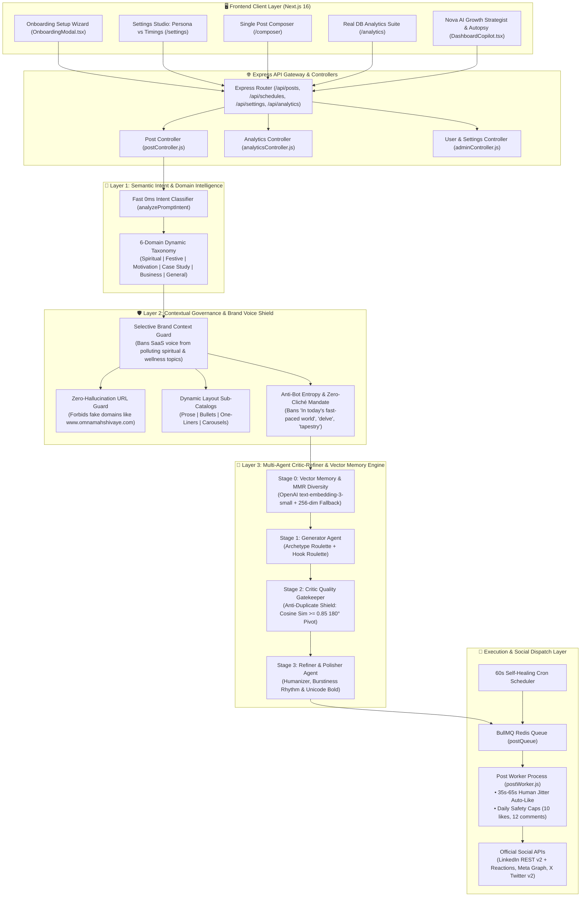
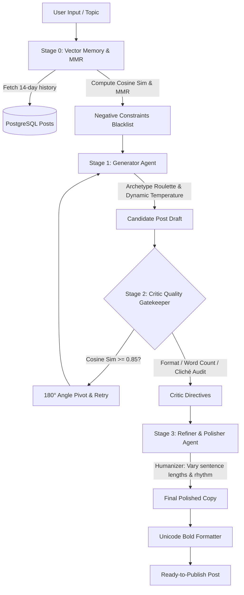
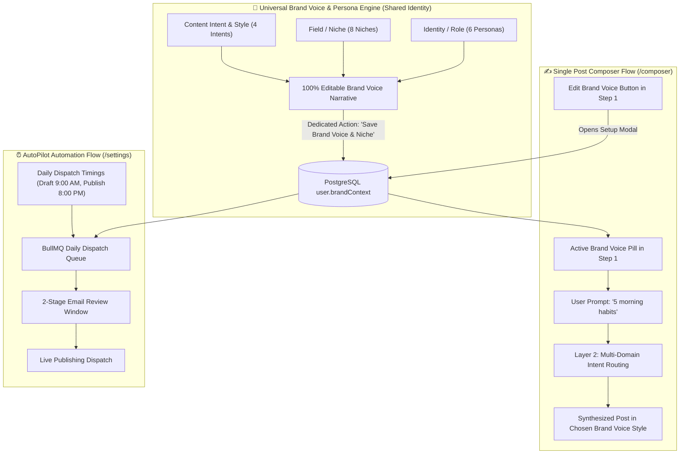
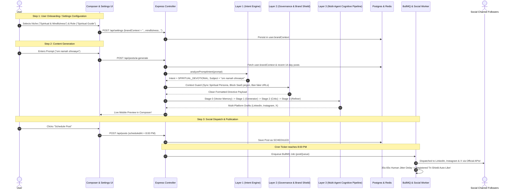

# 🏛️ OmniSync (Social Autopilot) — Complete Engine Architecture & System Flow

> **Version:** 2.2.0  
> **Status:** Production-Ready & Multi-Domain AI Enabled with Vector Memory, Persona Studio & Tri-Shield Anti-Bot Safety  
> **Scope:** Definitive architectural blueprint of all core engines, data pipelines, domain routing, persona customization, LinkedIn safety shields, and platform dispatchers.

---

## 📑 Table of Contents
1. [Master System Topology](#-1-master-system-topology)
2. [Engine 1: AI Intent & Domain Intelligence Engine (Layer 1)](#-2-engine-1-ai-intent--domain-intelligence-engine-layer-1)
3. [Engine 2: Contextual Governance & Brand Voice Shield (Layer 2)](#-3-engine-2-contextual-governance--brand-voice-shield-layer-2)
4. [Engine 3: Multi-Agent Critic-Refiner & Vector Memory Engine (Layer 3)](#-4-engine-3-multi-agent-critic-refiner--vector-memory-engine-layer-3)
5. [Engine 4: Universal Brand Voice & Niche Customization Studio](#-5-engine-4-universal-brand-voice--niche-customization-studio)
6. [Engine 5: Adaptive Multi-Platform Synthesis Engine](#-6-engine-5-adaptive-multi-platform-synthesis-engine)
7. [Engine 6: Visual Studio & Single-Pass Multimodal Prompt Engine](#-7-engine-6-visual-studio--single-pass-multimodal-prompt-engine)
8. [Engine 7: Virality Diagnostic, Dwell-Time & Post Autopsy Engine](#-8-engine-7-virality-diagnostic-dwell-time--post-autopsy-engine)
9. [Engine 8: Smart Contextual Engagement & LinkedIn Tri-Shield Safety Engine](#-9-engine-8-smart-contextual-engagement--linkedin-tri-shield-safety-engine)
10. [Engine 9: 30-Day Anti-Repetition & Historical DB Memory Engine](#-10-engine-9-30-day-anti-repetition--historical-db-memory-engine)
11. [Engine 10: PostgreSQL Real Analytics & Telemetry Suite](#-11-engine-10-postgresql-real-analytics--telemetry-suite)
12. [Engine 11: Self-Healing Cron Scheduler & BullMQ Dispatcher](#-12-engine-11-self-healing-cron-scheduler--bullmq-dispatcher)
13. [Engine 12: Social Connection Health, Token Expiration & Alert Matrix](#-13-engine-12-social-connection-health-token-expiration--alert-matrix)
14. [Cross-Niche Comparative Synthesis Table](#-14-cross-niche-comparative-synthesis-table)
15. [End-to-End Sequence Flow & Lifecycle](#-15-end-to-end-sequence-flow--lifecycle)
16. [Key Architectural Invariants](#-16-key-architectural-invariants)

---

## 🗺️ 1. Master System Topology

OmniSync operates on a **Decoupled Multi-Layer Architecture** that separates semantic intent discovery, contextual governance, cognitive quality gates, and multi-platform social dispatch.



---

## 🧠 2. Engine 1: AI Intent & Domain Intelligence Engine (Layer 1)

### Purpose & Architecture
Located in [`aiService.js -> analyzePromptIntent`](file:///C:/Users/AYUSH%20RAJ/Documents/ayush/social-autopilot/backend/src/services/aiService.js), Layer 1 acts as the **Semantic Ingestion Gateway**. It takes any raw prompt or article URL and determines its authentic domain without forcing a rigid tech/startup mold.

### The 6-Domain Dynamic Taxonomy:
| Domain Key | Target Audience | Core Focus | Tone & Hook Style |
| :--- | :--- | :--- | :--- |
| **`SPIRITUAL_DEVOTIONAL`** | Seekers, Mindful community, Devotees | Inner peace, stillness, timeless wisdom, resilience, grounding | Sacred, peaceful, profound reflection. **Zero SaaS or Tech Jargon.** |
| **`CULTURE_FESTIVAL`** | General community, Family, Friends | Joyful celebration, auspicious blessings, gratitude | Festive warmth, auspicious wishes, cultural heritage. |
| **`MOTIVATION_WELLNESS`** | Self-improvers, Athletes, Daily strivers | Discipline, habit building, mental resilience | Sharp mindset shifts, practical daily habits, transformational truths. |
| **`PRODUCT_CASE_STUDY`** | Founders, Product Leaders, Tech Builders | Solving customer friction, product-led scale | Forensic breakdown, contrarian truth, acquisition stories. |
| **`BUSINESS_INSIGHT`** | Industry professionals, Team leaders | Strategic execution, career growth, management | High-signal industry frameworks, operational lessons. |
| **`GENERAL_INSIGHT`** | Broad network audience | Relatable experiences, authentic peer discussions | Engaging conversational questions and clear reflections. |

---

## 🛡️ 3. Engine 2: Contextual Governance & Brand Voice Shield (Layer 2)

### Purpose & Architecture
Layer 2 sits between the Intent Classifier and OpenAI. Its sole purpose is **context curation, hallucination prevention, and layout entropy**.

### 1. Selective Brand Voice Shield:
In many setups, users configure a business profile (e.g. *"SaaS social automation and startup marketing"*).
- **The Problem:** If a user with a SaaS brand profile enters `"Om Namah Shivaaye"`, blindly appending `brandContext` forces the LLM to hallucinate a SaaS app called *"Om Namah Shivaaye"*.
- **The Shield Guard:**
  ```javascript
  const isNonBusinessTopic = ['SPIRITUAL_DEVOTIONAL', 'CULTURE_FESTIVAL', 'MOTIVATION_WELLNESS'].includes(intent.primaryIntent);

  if (brandContext && !isNonBusinessTopic) {
    systemPrompt += `\n\n[USER BRAND VOICE & CONTEXT]\n${brandContext}`;
  } else {
    // Brand voice is cleanly omitted for spiritual/personal topics to prevent cross-pollution!
  }
  ```

### 2. Zero-Hallucination URL Guard:
- Forbids inventing fake URLs (e.g. `www.omnamahshivaye.com`).
- Official links are ONLY included if:
  1. The user explicitly passed a URL (e.g. `{{link}}` or `https://mysite.com`).
  2. The topic is an established, real-world company in a case study (e.g. Loom, Skyscanner, Canva).

### 3. Anti-Bot Entropy & Sub-Layout Catalogs:
To prevent algorithmic pattern detection by social platforms, each format option dynamically rotates across rich sub-archetypes:
- **Standard Paragraphs (`PARAGRAPHS`):** Pure prose (strictly 0 bullets, 0 pins).
  - `PARAGRAPHS_NARRATIVE_ARC`: Scene Hook $\rightarrow$ Deep Middle $\rightarrow$ Grounded Lesson.
  - `PARAGRAPHS_PHILOSOPHICAL_INVERSION`: External Noise $\rightarrow$ Inward Stillness $\rightarrow$ Practical Clarity.
  - `PARAGRAPHS_TRIAD_PROSE`: 3 balanced, high-rhythm prose paragraphs.
  - `PARAGRAPHS_METAPHORIC_DEEP_DIVE`: Physical/natural metaphor unpacked into daily resilience.
- **Bullet Points (`BULLETS`):**
  - `BULLETS_PROGRESSIVE_NUMBERED`: Clean double digits (`01.`, `02.`, `03.`).
  - `BULLETS_VARIED_CONTEXTUAL_EMOJIS`: Context-relevant emojis unique to each takeaway (no repeating pins).
  - `BULLETS_CONTRAST_PAIRS`: High-contrast comparison pairs (`❌ Trap` vs `✅ Shift`).
  - `BULLETS_EXECUTIVE_DASH`: Minimalist em-dashes (`—`) or clean bullet dots (`•`).
- **Punchy One-Liners (`ONE_LINERS`):** Truth Cascade, Contrarian Paradox, Minimalist Manifesto.
- **Carousels (`CAROUSEL`):** Step-by-Step Blueprint, Transformation Journey, Affirmations Deck.
- **Anti-Cliché Mandate:** Explicitly bans generic AI filler phrases: `"In today's fast-paced world"`, `"delve into"`, `"tapestry"`, `"game-changer"`, `"testament"`, `"Let that sink in"`, `"Agree?"`, and `"🎯 Moral of the story:"`.

---

## 🔬 4. Engine 3: Multi-Agent Critic-Refiner & Vector Memory Engine (Layer 3)

Located across [`vectorMemoryService.js`](file:///C:/Users/AYUSH%20RAJ/Documents/ayush/social-autopilot/backend/src/services/ai/vectorMemoryService.js) and [`aiService.js`](file:///C:/Users/AYUSH%20RAJ/Documents/ayush/social-autopilot/backend/src/services/aiService.js), this multi-agent cognitive pipeline ensures zero template fatigue and high human burstiness.



### Stage 0: Relevance & Diversity Context Retrieval (Vector Memory & MMR)
1. **Embedding Generation:** Uses OpenAI `text-embedding-3-small` (1,536 dims) with an LRU cache. Transparently degrades to a 256-dimensional character N-gram hashing vectorizer when offline or in test environments.
2. **Maximal Marginal Relevance (MMR):**
   $$\text{MMR} = \operatorname*{argmax}_{d_i \in R \setminus S} \left[ \lambda \operatorname{Sim}(d_i, Q) - (1 - \lambda) \max_{d_j \in S} \operatorname{Sim}(d_i, d_j) \right]$$
   Balances semantic relevance with feed diversity ($\lambda = 0.55$).
3. **The Anti-Repetition Blacklist:** Extracts opening hooks and keywords from the user's past 14 days of dispatches, forbidding the Generator from reusing opening hooks or identical formulas.

### Stage 1: The Generator Agent (Creative Drafting)
- **Archetype Roulette:** Selects from 5 structural archetypes (*Contrarian Narrative*, *Tactical Playbook*, *Punchy Micro-Statement*, *Forensic Teardown*, *3-Step Framework*), calibrating temperature between $0.80$ and $0.86$.
- **Hook Roulette:** Selects an unexpected opening strategy (*Contrarian Flip*, *Forensic Metric / In-Media-Res*, *Honest Observation*, *Perspective Shift*, *Direct Provocative Question*).
- **Single-Pass Visual Extraction:** When `includeImage = true`, returns both the post copy and a dedicated 3D visual generation prompt in one unified JSON payload.

### Stage 2: The Critic & Quality Gatekeeper Agent
- **Anti-Duplicate Shield:** Computes cosine similarity between the candidate draft and recent dispatches.
  - If **Cosine Similarity $\ge 0.85$**, triggers an immediate **180-degree pivot** with higher temperature ($0.88$) and an alternate structural archetype.
- **Rule Audits:**
  - *Format Integrity Audit:* Strips rogue bullet points if Standard Paragraphs was selected.
  - *Word Count Audit:* Trims concise drafts to 40-70 words; expands long-form posts to 250-450 words.
  - *Preachiness & Cliché Audit:* Flags schoolteacher lectures and AI buzzwords.
  - *Emoji Density Audit:* Enforces exact user limits (`NONE`, `MINIMAL`, `BALANCED`, `EXPRESSIVE`).

### Stage 3: The Refiner & Polisher Agent (Humanizer & Rhythm)
- **Burstiness & Human Cadence:** Varies sentence lengths naturally (e.g. 4-word punchy sentence followed by an 18-word descriptive sentence, followed by a short punchline) to defeat AI detection tools.
- **Unicode Bold Transformation:** Converts markdown asterisks (`**Bold**`) into native Unicode mathematical bold (`𝐁𝐨𝐥𝐝`) for clean rendering on LinkedIn, X, and Instagram.

---

## 🎛️ 5. Engine 4: Universal Brand Voice & Niche Customization Studio

Located across [`OnboardingModal.tsx`](file:///C:/Users/AYUSH%20RAJ/Documents/ayush/social-autopilot/frontend/src/components/OnboardingModal.tsx), [`composer/page.tsx`](file:///C:/Users/AYUSH%20RAJ/Documents/ayush/social-autopilot/frontend/src/app/composer/page.tsx), and [`settings/page.tsx`](file:///C:/Users/AYUSH%20RAJ/Documents/ayush/social-autopilot/frontend/src/app/settings/page.tsx).



### Decoupled Settings Architecture (`/settings`):
Settings are split into two independent cards with dedicated handlers:
1. **Card 1: Brand Voice & Niche Profile (`handleSaveBrandPersona`):** Governs Brand Name, Persona, Niche, Intent, and Voice narrative (`user.brandContext`). Modifying this **never** alters schedule slots or Autopilot toggles.
2. **Card 2: AutoPilot Recurring Schedule Timings (`handleSaveAutopilotSchedule`):** Controls the master Autopilot toggle, draft time, live publish time, and timezone. Modifying this **never** overwrites the brand voice narrative.

### The 3D Personalization Matrix:
- **6 Personas:** Founder / Builder, Content Creator, Spiritual / Mindfulness Guide, Fitness Coach, Agency / Business Brand, Industry Thought Leader.
- **8 Niches:** Tech & SaaS, Spiritual & Mindfulness, Health & Fitness, Business & Startups, Education & Career, Design & Creative, E-Commerce & Retail, Custom Field.
- **4 Intents:** High Virality & Growth, Deep Authority & Teardowns, Mindful & Heartfelt Reflection, Actionable Step-by-Step Guides.

---

## ⚡ 6. Engine 5: Adaptive Multi-Platform Synthesis Engine

Layer 3 executes parallel adaptations, ensuring copy is tuned for each network's algorithmic expectations:

- **LinkedIn:** 1-2 sentence mobile dwell spacing, clean takeaway headers, polarizing comment CTA, 3-5 niche tags at bottom.
- **Instagram:** Pattern-interrupt hook in first 2 lines, slide outline or caption, 8-15 hashtags separated after a double blank line.
- **X (Twitter):** Single tweet strictly under 270 characters (or multi-part numbered thread `1/`, `2/`, `3/`), 0-2 minimal hashtags.
- **Facebook:** Community-first conversational tone, open question encouraging replies, 3-5 hashtags.

---

## 🎨 7. Engine 6: Visual Studio & Single-Pass Multimodal Prompt Engine

When `includeImage = true`, OpenAI generates both post copy and a structured visual generation prompt in **one single API call** (saving 50% latency and token cost):

```json
{
  "content": "Full formatted post copy with unicode bold and clean spacing...",
  "visualMeta": {
    "brandName": "OmniSync",
    "coreSubject": "Async Workflow Automation",
    "niche": "TECH_STARTUP",
    "visualPrompt": "Minimalist isometric 3D translucent glassmorphic cards floating in soft ambient blue studio lighting, clean negative space, 8k render."
  }
}
```

### 3-Tier Architecture & Diffusion Foundations
1. **Tier 1 (Fal.ai Flux.1 Schnell):** Fast 0.15s ultra-HD inference ($0.0035/image), used as primary diffusion engine.
2. **Tier 2 (OpenAI DALL-E 3):** Prompt fidelity champion, invoked with 12s race timeout fallback.
3. **Tier 3 (Local Sharp SVG Card Engine):** Zero-cost local 1080x1080 vector graphic cards (`BRANDED_SVG_CARD`).

### Hybrid Sharp Typography Compositing Pipeline ("The Secret Sauce")
To prevent diffusion AI models from generating distorted or misspelled text:
1. Diffusion model creates a pristine background image with subject placed on the right side and clean dark negative space on the left side.
2. Node.js `sharp` library downloads the background buffer, applies a dark progressive gradient scrim, and composites high-contrast SVG vector typography:
   - **Category Tag Pill:** `TECH TEARDOWN`, `GROWTH PLAYBOOK`, or `SACRED INSIGHT`
   - **Hero Hook Headline:** Clean, multi-line auto-wrapped headline (`heroHook`)
   - **Brand Watermark:** Monogram logo badge and brand name
3. Gives users 100% legibility and zero spelling errors.

### Multi-Channel Aspect Ratio Engine
Supports 3 channel-optimized aspect ratios:
- **`1:1` Square (1080×1080):** Optimized for LinkedIn & Instagram Feeds (`square_hd`).
- **`16:9` Landscape (1200×675):** Optimized for X (Twitter), Reddit, and Facebook (`landscape_16_9`).
- **`4:5` Portrait (1080×1350):** Optimized for mobile feed vertical scrolling (`portrait_4_3`).

---

## 📊 8. Engine 7: Virality Diagnostic, Dwell-Time & Post Autopsy Engine

Located in [`recommendationEngine.ts`](file:///C:/Users/AYUSH%20RAJ/Documents/ayush/social-autopilot/frontend/src/utils/recommendationEngine.ts) and [`DashboardCopilot.tsx`](file:///C:/Users/AYUSH%20RAJ/Documents/ayush/social-autopilot/frontend/src/components/DashboardCopilot.tsx):

### Algorithmic Health Scoring (0-100 Index):
- **Hook Curiosity (25%):** Evaluates opening pattern-interrupt strength and curiosity gaps.
- **Mobile Dwell-Time Formatting (25%):** Penalizes dense walls of text; rewards 1-2 sentence paragraph breaks.
- **Viral Shareability & Takeaways (25%):** Rewards clear framework headers and actionable value density.
- **CTA & Algorithm Friction (25%):** Detects algorithmic penalties:
  - *LinkedIn External Link Penalty:* Warns when body links throttle organic feed distribution by up to 40%.
  - *Missing Discussion Question:* Flags posts lacking an open-ended comment prompt.

### Nova AI Post Autopsy:
Integrated into the sticky Copilot widget. Asking Nova *"why did my last post reach stall?"* triggers a 0-token instant audit analyzing the newest dispatch in PostgreSQL, pinpointing reach bottlenecks, and outputting an AI-rewritten viral hook ready for Composer with 1 click.

---

## 🛡️ 9. Engine 8: Smart Contextual Engagement & LinkedIn Tri-Shield Safety Engine

Located in [`postWorker.js`](file:///C:/Users/AYUSH%20RAJ/Documents/ayush/social-autopilot/backend/src/workers/postWorker.js) and [`linkedinService.js`](file:///C:/Users/AYUSH%20RAJ/Documents/ayush/social-autopilot/backend/src/services/social/linkedinService.js):

### Tri-Shield Anti-Bot Protection:
1. **Human Jitter Delay (35s to 65s):** Auto-likes no longer fire at an unnatural 2-second timestamp. A randomized jitter delay mimics authentic human reading speed before dispatching the reaction.
2. **Daily Rate Limit Caps:**
   - Maximum **10 auto-likes per 24 hours**.
   - Maximum **12 auto-comments per 24 hours**.
   - Shield checks the database before execution and skips actions if limits are reached.
3. **Dual-Endpoint API Resilience:**
   - Primary: LinkedIn `/socialActions/{postUrn}/reactions` (v2 protocol).
   - Fallback: Versioned `rest/reactions?actor={actorUrn}` with automated header downgrade.

---

## 🧠 10. Engine 9: 30-Day Anti-Repetition & Historical DB Memory Engine

Located in [`memoryService.js`](file:///C:/Users/AYUSH%20RAJ/Documents/ayush/social-autopilot/backend/src/services/ai/memoryService.js):
- Automatically stores dispatches in PostgreSQL (`Post`) and Redis cache.
- Decrypts historical dispatches within a rolling 30-day window and injects mandatory topic exclusions into prompt directives.
- Guarantees that automated background schedules **never repeat identical subjects or case studies** across consecutive runs.

---

## 📈 11. Engine 10: PostgreSQL Real Analytics & Telemetry Suite

Located in [`analyticsService.js`](file:///C:/Users/AYUSH%20RAJ/Documents/ayush/social-autopilot/backend/src/services/analyticsService.js) and [`frontend/src/app/analytics/page.tsx`](file:///C:/Users/AYUSH%20RAJ/Documents/ayush/social-autopilot/frontend/src/app/analytics/page.tsx):

- **Real Database Aggregation:** Replaced hardcoded charts with live queries across **7D, 30D, 90D, and YTD** windows.
- **Publishing Cadence Telemetry:** Computes the user's empirical peak day (e.g. Thursday) and peak hour (e.g. 10:00 AM) from published post history.
- **Interactive Telemetry:** Includes time-series trajectory charts, format share multipliers, channel distribution donuts, top-performing post rankings, and CSV export.

---

## ⏰ 12. Engine 11: Self-Healing Cron Scheduler & BullMQ Dispatcher

Located in [`scheduleService.js`](file:///C:/Users/AYUSH%20RAJ/Documents/ayush/social-autopilot/backend/src/services/scheduleService.js):

### Dual-Cadence Review Workflow:
1. **Stage 1 (Morning Draft Alert - e.g. 09:00 AM):** AI synthesizes drafts in the background and sends an email review preview with 1-click Approve or Edit links.
2. **Stage 2 (Live Publish - e.g. 08:00 PM):** Queues the approved post into the BullMQ Redis queue for live broadcasting.

### The Self-Healing Ticker:
- Runs every **60 seconds**.
- Evaluates `nowTotalMinutes >= targetTotalMinutes` against user timezones.
- Fail-safe logic ensures schedules are executed immediately even if the server experienced lag or rebooted during the exact minute.
- Automatically unlocks posts stuck in `PUBLISHING` status for $> 2$ minutes.

---

## 🔌 13. Engine 12: Social Connection Health, Token Expiration & Alert Matrix

Located in [`tokenManager.js`](file:///C:/Users/AYUSH%20RAJ/Documents/ayush/social-autopilot/backend/src/services/auth/tokenManager.js), [`tokenRefreshJob.js`](file:///C:/Users/AYUSH%20RAJ/Documents/ayush/social-autopilot/backend/src/jobs/tokenRefreshJob.js), [`socketService.js`](file:///C:/Users/AYUSH%20RAJ/Documents/ayush/social-autopilot/backend/src/services/socketService.js), and [`emailService.js`](file:///C:/Users/AYUSH%20RAJ/Documents/ayush/social-autopilot/backend/src/services/emailService.js):

### Platform Expiration & Token Lifecycle Matrix
| Platform | Access Token Lifespan | Refresh Mechanism | Fallback / Expired State |
|---|---|---|---|
| **LinkedIn** | **60 Days** (`expires_in = 5184000`) | Proactive refresh via OAuth adapter | Re-authorization popup required if expired |
| **Instagram** | **60 Days** (Long-Lived Meta Graph User Token) | Graph API `refresh_access_token` endpoint | Re-authentication required if 60 days lapse |
| **Facebook** | **60 Days** (Long-Lived Page Access Token) | Refreshed with Meta User Token | Invalidated on password reset or permission revocation |
| **X (Twitter)** | **2 Hours** (`expires_in = 7200`) | OAuth 2.0 PKCE `refreshToken` rotation | Refreshed continuously in background |
| **User JWT** | **15 Minutes** (Access) / **30 Days** (Refresh) | `/api/auth/refresh-token` endpoint | Re-login required after 30 days inactivity |

### Multi-Tier Detection Engine
1. **Pre-Publish Runtime Validation:** Prior to publishing, `postWorker.js` calls `tokenManager.getValidAccessToken`. If token is within 5 minutes of expiration, it attempts immediate refresh.
2. **Proactive 7-Day Background Cron:** `tokenRefreshJob.js` scans daily for accounts with `expiresAt <= now + 7 days` to proactively renew tokens before they ever expire.
3. **Real-Time Client Verification:** `socketService.js` detects expired sessions upon `check_platform` socket queries from UI.

### Automated Disconnect & Alert Dispatch Pipeline
When a token cannot be refreshed (revoked access, changed password, or expired OAuth session):
1. **PostgreSQL Inactivation:** Sets `SocialAccount.isActive = false`.
2. **Redis Invalidation:** Purges cache key `USER_SOCIAL_ACCOUNTS(userId)`.
3. **WebSockets (Real-time Push):**
   - Emits `account_status_changed` (`action: 'DISCONNECTED'`) so channel chips in all open tabs instantly transition to offline status.
   - Emits `notification:new` triggering an immediate floating alert toast on the active dashboard.
4. **Urgent Transactional Email Alert:**
   - Dispatches `sendAccountDisconnectedEmail` with direct action button: `Reconnect {Platform} Account` pointing to `/accounts`.

---

## 📊 14. Cross-Niche Comparative Synthesis Table

Demonstrating how the **Persona & Niche Engine** adapts the **exact same prompt** (`"5 morning habits"`):

| User Niche | Selected Persona | Hook & Opening Line | 3 Core Takeaways / Lessons | Closing CTA & Hashtags |
| :--- | :--- | :--- | :--- | :--- |
| **🕉️ Spiritual & Mindfulness** | Spiritual Guide | *"Before the world demands your attention, the morning offers a sacred silence..."* | 1. Conscious breathwork<br>2. Mindful stillness<br>3. Gratitude surrender | *"How do you ground yourself before the noise begins? Let's reflect below."*<br>`#Mindfulness #InnerPeace` |
| **⚡ Health & Fitness** | Fitness Coach | *"Most people wait for motivation. Athletes build an indestructible morning routine..."* | 1. 500ml cold hydration<br>2. Dynamic mobility drill<br>3. 30g protein foundation | *"What is the 1 habit you never skip in the morning? Drop it below!"*<br>`#FitnessHabits #DailyDiscipline` |
| **🚀 Tech & SaaS** | Startup Founder | *"The first 90 minutes of your workday dictate your architecture's velocity..."* | 1. Zero Slack until 10 AM<br>2. High-leverage code block<br>3. Async standup review | *"Do you check email first thing or protect your deep work? Be honest below."*<br>`#DeveloperProductivity #SaaS` |
| **💼 Business & Startups** | Agency Brand | *"Scaling to 7-figures isn't about working more hours—it's about how you open your day..."* | 1. High-leverage KPI audit<br>2. Eliminating bottleneck friction<br>3. Team empowerment | *"What is the single biggest bottleneck in your current business stack?"*<br>`#BusinessGrowth #Leadership` |

---

## 🔄 15. End-to-End Sequence Flow & Lifecycle



---

## 🏆 16. Key Architectural Invariants

1. **Topic Fidelity First:** What the user types is preserved. The engine never overrides personal, spiritual, or artistic topics with tech business jargon.
2. **Persona-Aware Synthesis:** Content naturally inherits the user's chosen field (Spiritual, Fitness, Tech, Business) while respecting individual prompt nuances.
3. **100% User Freedom & Editability:** Every AI preset is fully customizable; users can switch niches at any time without server restarts.
4. **Zero Hallucinated Links:** Never invent `.com` URLs. Real links only when provided or describing real historical companies.
5. **Decoupled 3-Layer Pipeline:** Semantic Parsing $\rightarrow$ Contextual Governance $\rightarrow$ Multi-Agent Synthesis.
6. **Self-Healing Execution:** Zero skipped cron jobs; auto-recovering token refreshers and fail-safe timeouts.
